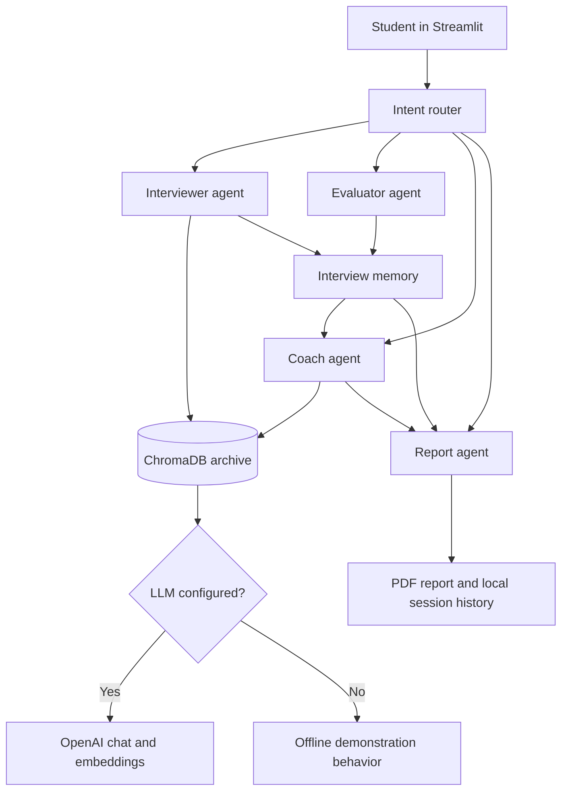

# Company-Smart Mock Interview Coach

A modular Streamlit demonstration for company- and role-specific mock interviews. It uses LangChain agents, ChromaDB retrieval, structured answer evaluation, coaching, and downloadable PDF reports.

> **Data note:** `data/sample_interviews.csv` is synthetic demonstration data. Its feedback is explicitly labeled as demonstration feedback; it is not institutional history and must not be presented as verified company interview experience. Upload an authorized institutional CSV archive to use real records.

## Features

- Four separate agents: interviewer, evaluator, coach, and report generator.
- ChromaDB retrieval over questions, expected answer points, candidate feedback, and common mistakes.
- Technical, HR, coding, aptitude, and mixed interview modes.
- Scores for technical correctness, depth, communication, and problem solving (each /10; total /40).
- Difficulty adjustment based on recent scores.
- Local session history and downloadable PDF report.
- Works without credentials in offline demonstration mode. The local feature-hashing embeddings and scoring are intentionally approximate, not a substitute for an LLM or a human evaluator.
- Optional OpenAI chat and embedding models, configured via environment or Streamlit secrets.

## Install

Use Python 3.10 or later. In PowerShell, from the project directory:

```powershell
py -m venv .venv
.\.venv\Scripts\Activate.ps1
python -m pip install --upgrade pip
pip install -r requirements.txt
streamlit run app.py
```

If PowerShell blocks activation, run the environment's executable directly:

```powershell
.\.venv\Scripts\python.exe -m pip install -r requirements.txt
.\.venv\Scripts\python.exe -m streamlit run app.py
```

## Configure OpenAI (optional)

Set `OPENAI_API_KEY` in the process environment or add `.streamlit/secrets.toml`:

```toml
OPENAI_API_KEY = "your-key"
```

Do not commit secrets. Set `OPENAI_MODEL` in the environment to select another model supported by your account; default is `gpt-4o-mini`.

With a key configured, the application uses OpenAI chat and embeddings. The archive text is sent to OpenAI to create embeddings; retrieved excerpts and student answers are sent for question generation, evaluation, and coaching. Chroma stores the resulting index in the current app process. Use offline mode for data that must remain local, and follow your institution's privacy and data handling rules.

## Upload an institutional archive

Use the sidebar CSV uploader. The UTF-8 CSV must contain these column names (case-insensitive):

```text
company,job_role,interview_question,interview_category,difficulty_level,expected_answer_points,historical_candidate_feedback,common_mistakes
```

Use semicolons between multiple expected answer points. Only upload records you are authorized to process. Uploaded records are held in memory and indexed by ChromaDB for the app session. Completed answers and scores are stored locally in `data/session_history.json`; that file is excluded from version control.

## Agent architecture



The router maps start, evaluate, coaching, and report requests to the corresponding workflow. Interview memory tracks the selected company/role, questions, answers, and scores for the current session. The interviewer retrieves archive context and adapts difficulty from recent evaluation scores. The coach retrieves role-specific feedback and mistakes. The report aggregates scores, coaching topics, answers, and readiness guidance.

## Project files

- `app.py` — Streamlit dashboard, interview flow, and report UI.
- `interviewer_agent.py`, `evaluator_agent.py`, `coach_agent.py`, `report_agent.py` — the four agents.
- `rag_pipeline.py` — ChromaDB and offline/OpenAI embeddings.
- `intent_router.py` — intent mapping.
- `memory_manager.py` — session memory and local session history.
- `data_loader.py` — CSV validation and loading.
- `config.py`, `llm_client.py` — configuration and LLM setup.
- `data/sample_interviews.csv` — synthetic demonstration archive.

## Notes

- The local feature-hashing embeddings are an offline fallback; configure OpenAI for semantic embeddings and LLM-based evaluation.
- Session history contains student answers. Keep it on a trusted device and remove it according to your institution's retention policy.
- This tool supports practice and does not guarantee placement or hiring outcomes.
